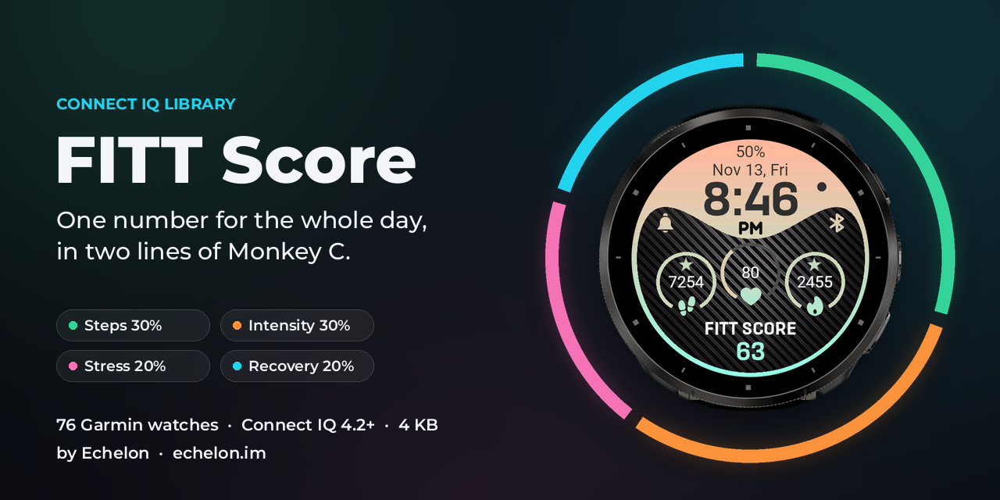
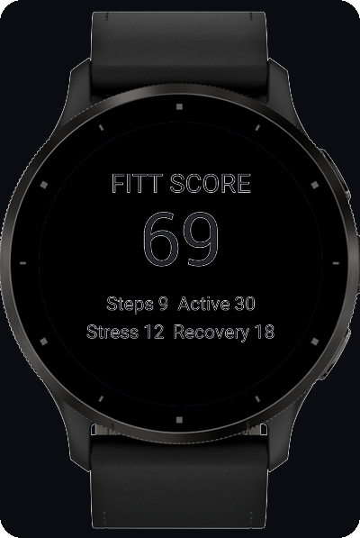
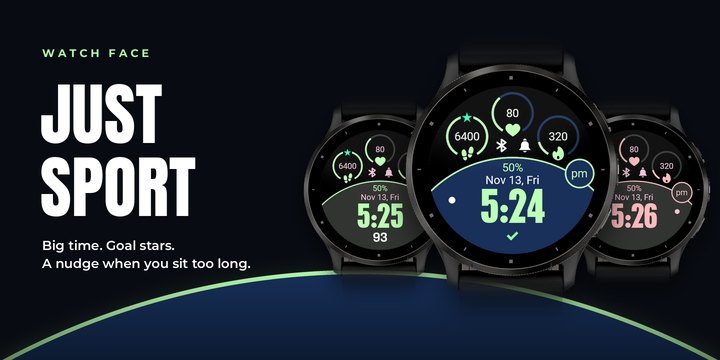
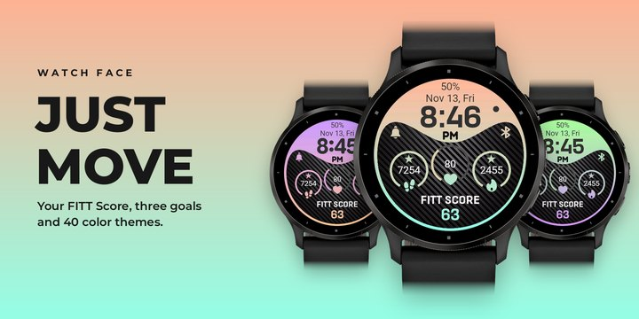
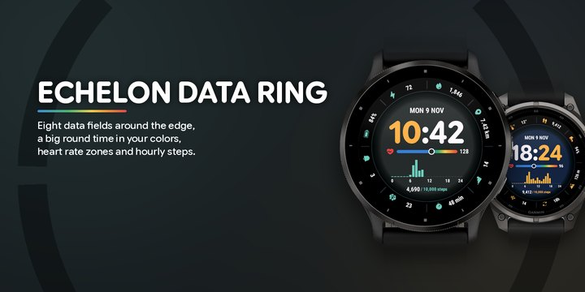
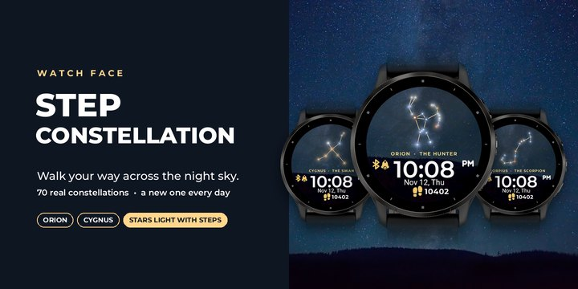

<p align="center">
  
</p>

<h1 align="center">FITT Score for Connect IQ</h1>

<p align="center">
  <b>One daily score from 0 to 100 for your Garmin watch face, widget or data field – in two lines of Monkey C.</b>
</p>

<p align="center">
  
  
  
  
  
</p>

<p align="center">
  <a href="https://echelon.im/st/fitt-score.html">Website &amp; live calculator</a> ·
  <a href="#quick-start">Quick start</a> ·
  <a href="#api">API</a> ·
  <a href="#supported-watches">Watches</a> ·
  <a href="#license">License</a>
</p>

---

## What is the FITT Score?

Moving more is only half of fitness. The **FITT Score** balances how much the user moved and how hard they
trained with how stressed they are and how well they have recovered – all from data the Garmin watch already
measures, using the user's own goals from Garmin Connect.

| Part | Weight | What counts |
|---|:---:|---|
| 🟢 **Steps** | 30% | Steps toward the user's own daily step goal |
| 🟠 **Intensity minutes** | 30% | Today's share of the weekly goal, or the weekly goal already reached (vigorous minutes count double) |
| 🩷 **Stress** | 20% | Low stress = more points, averaged over the last 3 hours |
| 🔵 **Recovery** | 20% | Body Battery and recovery time, whichever the watch provides |

```
FITT = Steps × 30 + Intensity × 30 + (1 − Stress) × 20 + Recovery × 20
```

- **Capped at 100%** – going past a goal adds no extra points, so one huge day cannot hide a lack of rest.
- **Fair on every watch** – if a watch has no data for a part, that part is left out and the others are scaled up. No free points, no penalty.
- **Battery friendly** – the score changes slowly, so it is recalculated at most once a minute.

Try it with your own numbers in the [live calculator](https://echelon.im/st/fitt-score.html#calculator).

## Quick start

**1. Download** [`FittScore.barrel`](FittScore.barrel) (or the latest
[release](https://github.com/ztuskes/fitt-score/releases)) and copy it into your project, e.g. `barrels/FittScore.barrel`.

**2. Point your jungle file to it** – `monkey.jungle`:

```properties
base.barrelPath = barrels/FittScore.barrel
```

**3. Add the dependency and the permissions** – `manifest.xml`, inside `<iq:application>`:

```xml
<iq:barrels>
    <iq:depends name="FittScore" version="1.0.0"/>
</iq:barrels>

<iq:permissions>
    <iq:uses-permission id="SensorHistory"/>
    <iq:uses-permission id="ComplicationSubscriber"/>
</iq:permissions>
```

> In VS Code you can also run **Monkey C: Configure Monkey Barrels** and pick the file.

**4. Show the score:**

```monkeyc
function onUpdate(dc) {
    var score = FittScore.getScore();          // 0..100

    dc.setColor(Graphics.COLOR_WHITE, Graphics.COLOR_TRANSPARENT);
    dc.drawText(dc.getWidth() / 2, dc.getHeight() / 2, Graphics.FONT_NUMBER_HOT,
                score.toString(), Graphics.TEXT_JUSTIFY_CENTER | Graphics.TEXT_JUSTIFY_VCENTER);
}
```

## API

### `FittScore.getScore()` → `Number`

The FITT Score from **0 to 100**. Cached for 60 seconds, so it is safe to call from every `onUpdate()`.

### `FittScore.getComponents()` → `Dictionary` or `null`

The points of each part after weighting, and the total. Returns `null` when the watch has no activity info.

```monkeyc
var parts = FittScore.getComponents();
if (parts != null) {
    parts["steps"];          // 0..30
    parts["activeMinutes"];  // 0..30
    parts["stress"];         // 0..20
    parts["recovery"];       // 0..20
    parts["total"];          // 0..100
}
```

> When a watch lacks a sensor, the remaining parts are scaled up, so on that watch a part can be worth more
> than its nominal weight. The total is always out of 100.

### Data it reads

| Source | Used for |
|---|---|
| `ActivityMonitor.getInfo()` | steps, step goal, intensity minutes (day / week / weekly goal), stress, time to recovery |
| `SensorHistory.getStressHistory()` | stress average of the last 3 hours |
| `SensorHistory.getBodyBatteryHistory()` | latest Body Battery |
| `Complications` (recovery time) | recovery hours on newer watches |

Everything is read on the watch – no network, no phone, no storage.

## Example

The [`example/`](example) folder is a minimal watch face that shows the score and its four parts.

<p align="center"></p>

```bash
monkeyc -f example/monkey.jungle -d venu3 -o example/bin/example.prg -y <your developer key>
monkeydo example/bin/example.prg venu3
```

## Supported watches

All **76 Garmin watch models with Connect IQ 4.2 or later**.

<details>
<summary><b>Show all 76 models</b></summary>

| Family | Models |
|---|---|
| **Approach** | Approach S50, Approach S70 42mm, Approach S70 47mm, Approach S72 43mm, Approach S72 47mm |
| **D2** | D2 Air X10, D2 Mach 1, D2 Mach 2, D2 Mach 2 Pro |
| **Descent** | Descent G2, Descent Mk3 43mm / Mk3i 43mm, Descent Mk3i 51mm |
| **Enduro** | Enduro 3, Enduro 4 |
| **epix** | epix (Gen 2) / quatix 7 Sapphire, epix Pro (Gen 2) 42mm, epix Pro (Gen 2) 47mm / quatix 7 Pro, epix Pro (Gen 2) 51mm / D2 Mach 1 Pro / tactix 7 – AMOLED Edition |
| **Forerunner** | Forerunner 70, Forerunner 165, Forerunner 165 Music, Forerunner 170, Forerunner 170 Music, Forerunner 255, Forerunner 255 Music, Forerunner 255s, Forerunner 255s Music, Forerunner 265, Forerunner 265s, Forerunner 570 42mm, Forerunner 570 47mm, Forerunner 955 / Solar, Forerunner 965, Forerunner 970 |
| **fēnix** | fēnix 7 / quatix 7, fēnix 7 Pro, fēnix 7 Pro - Solar Edition (no Wi-Fi), fēnix 7S, fēnix 7S Pro, fēnix 7X / tactix 7 / quatix 7X Solar / Enduro 2, fēnix 7X Pro, fēnix 7X Pro - Solar Edition (no Wi-Fi), fēnix 8 43mm, fēnix 8 47mm / 51mm / tactix 8 47mm / 51mm / quatix 8 47mm / 51mm, fēnix 8 Pro 47mm / 51mm / MicroLED / quatix 8 Pro 47mm / 51mm, fēnix 8 Solar 47mm, fēnix 8 Solar 51mm / tactix 8 Solar 51mm, fēnix 9 43mm, fēnix 9 47mm / 51mm, fēnix 9 Pro 43mm, fēnix 9 Pro 47mm, fēnix 9 Pro 51mm, fēnix 9 Pro Solar 47mm, fēnix 9 Pro Solar 51mm, fēnix E |
| **Instinct** | Instinct 3 AMOLED 45mm, Instinct 3 AMOLED 50mm, Instinct 3 Solar / Solar Tactical 45mm / 50mm, Instinct Crossover AMOLED, Instinct E 40mm, Instinct E 45mm |
| **MARQ** | MARQ (Gen 2) Athlete / Adventurer / Captain / Golfer / Carbon Edition / Commander - Carbon Edition, MARQ (Gen 2) Aviator, MARQ (Gen 3) Athlete / Adventurer / Aviator / Commander / Golfer / Diver |
| **Venu** | Venu 2, Venu 2 Plus, Venu 2S, Venu 3, Venu 3S, Venu 4 41mm, Venu 4 45mm / D2 Air X15, Venu X1 |
| **Venu Sq** | Venu Sq 2, Venu Sq 2 Music |
| **vívoactive** | vívoactive 5, vívoactive 6 |

</details>

## Used in

The FITT Score powers Echelon watch faces on the Connect IQ Store:

<table>
  <tr>
    <td width="50%"><a href="https://apps.garmin.com/apps/294e3b64-82c6-4d2f-bca7-24d412df46cb"></a><br><b>Just Sport</b> – big time, goal stars, Move Circles</td>
    <td width="50%"><a href="https://apps.garmin.com/apps/ad0beaee-cbfb-4e44-9f42-1d6d5d9dee9d"></a><br><b>Just Move</b> – FITT Score on the main screen</td>
  </tr>
  <tr>
    <td width="50%"><a href="https://apps.garmin.com/apps/f9edab23-d45e-438e-adc4-335d05c59016"></a><br><b>Echelon Data Ring</b> – 8 curved data fields</td>
    <td width="50%"><a href="https://apps.garmin.com/apps/dcb2d38b-3ba1-46d5-af52-235ac4a1b10a"></a><br><b>Step Constellation</b> – stars light up with your steps</td>
  </tr>
</table>

More faces: **[echelon.im/garmin](https://echelon.im/garmin/)**

## FAQ

<details>
<summary><b>Why is the score low in the morning?</b></summary>

Steps and intensity minutes start from zero at midnight, so the score grows during the day. Stress and recovery
count from the start, so a well-rested morning already gives a good base.
</details>

<details>
<summary><b>Does it use the user's own goals?</b></summary>

Yes – the step goal and the weekly intensity minutes goal from the user's Garmin Connect profile. Defaults
(10,000 steps, 150 minutes a week) are used only when the watch reports no goal.
</details>

<details>
<summary><b>Does it cost battery?</b></summary>

Very little. `getScore()` recalculates at most once a minute; in between it returns the cached value.
</details>

<details>
<summary><b>Can I use it in a paid app?</b></summary>

Yes, free or paid – see the license below. The one condition is the credit line.
</details>

<details>
<summary><b>Is it a medical measurement?</b></summary>

No. It is a motivational summary of data the watch already measures, meant to help build balanced daily habits.
</details>

## License

**Free to use, with credit.** Use the FITT Score in any Connect IQ app, free or paid. The one condition: add this
line to your app's store description and keep the name "FITT Score" wherever your app shows the score.

```
FITT Score by Echelon - https://echelon.im
```

Please don't resell, change or republish the library itself. Full terms: [LICENSE](LICENSE).

---

<p align="center">
  Made by <a href="https://echelon.im"><b>Echelon</b></a> · watch faces for Garmin and Wear OS ·
  <a href="https://echelon.im/st/fitt-score.html">FITT Score website</a>
</p>
